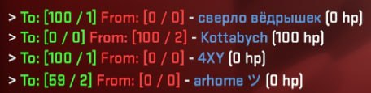
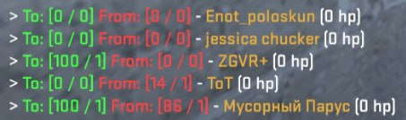

# DamageReport

**English** | [Русский](docs/README_RU.md)

A **Counter-Strike 2** plugin built on [CounterStrikeSharp](https://github.com/roflmuffin/CounterStrikeSharp) that shows each player, at the end of every round, how much damage they dealt to each opponent and how much they took in return.

<table>
<tr>
<td width="50%"></td>
<td width="50%"></td>
</table>

## Features

- A personal report for every opponent when the round ends.
- Counts **actual** health lost (HP before vs. after a hit), so overkill damage on a kill doesn't inflate the numbers.
- Shows damage, number of hits and the opponent's remaining health.
- Team damage and self-damage are ignored.
- Stats reset at the start of every round.
- No configuration needed: install it and it works.

## What it looks like

At the end of the round, every player on T or CT gets one line per opponent:

```
> To: [74 / 3] From: [27 / 1] - PlayerName (0 hp)
> To: [0 / 0] From: [100 / 2] - AnotherPlayer (100 hp)
```

| Field | Color | Meaning |
| --- | --- | --- |
| `To: [damage / hits]` | green | damage you dealt to this opponent and in how many hits |
| `From: [damage / hits]` | red | damage this opponent dealt to you and in how many hits |
| `PlayerName` | team color | the opponent's name |
| `(N hp)` | — | the opponent's health when the round ended |

<!--
More screenshots (uncomment once the files are added):

-->

## Requirements

- A CS2 server with [Metamod:Source](https://www.sourcemm.net/) and [CounterStrikeSharp](https://docs.cssharp.dev/) (the **with runtime** build).
- `CounterStrikeSharp.API` **1.0.373** or newer.
- To build from source: [.NET SDK 10](https://dotnet.microsoft.com/download) (the project targets `net10.0`).

## Installation

### From a release (recommended)

1. Download `DamageReport-<version>.zip` from the [Releases](https://github.com/FlamesC0der/DamageReport/releases) page.
2. Extract it into the `game/csgo/` folder of your server. The archive already contains the right path:

   ```
   addons/counterstrikesharp/plugins/DamageReport/
   ├── DamageReport.dll
   ├── DamageReport.deps.json
   └── DamageReport.pdb
   ```

3. Restart the server, or load the plugin from the server console:

   ```
   css_plugins load DamageReport
   ```

### Build from source

1. Build the plugin:

   ```bash
   git clone https://github.com/FlamesC0der/DamageReport.git
   cd DamageReport
   dotnet build -c Release
   ```

   The output appears in `.build/DamageReport/`.

2. Copy the `DamageReport` folder to your server so it looks like this:

   ```
   game/csgo/addons/counterstrikesharp/plugins/DamageReport/
   └── DamageReport.dll
   ```

   For example, with `rsync`:

   ```bash
   rsync -avz --delete \
     .build/DamageReport/ \
     user@your-server:/path/to/game/csgo/addons/counterstrikesharp/plugins/DamageReport
   ```

3. Restart the server, or load the plugin from the server console:

   ```
   css_plugins load DamageReport
   ```

### Updating without a restart

The plugin supports hot reload:

```
css_plugins reload DamageReport
```

## How it works

| Event | What the plugin does |
| --- | --- |
| `player_hurt` | Computes actual damage as `HP before − HP after` and records it per attacker → victim pair. Ignores team damage, self-damage and damage with no attacker (fall damage, world, etc.). |
| `round_start` | Clears the collected stats. |
| `round_end` | Sends every player a chat report covering all opponents. |

## Limitations

- Only players on T and CT receive the report; spectators don't see it.
- Starting health in a round is assumed to be 100 HP. If a game mode or another plugin gives more than 100 HP, the first hits may be counted inaccurately.
- There is no configuration (config file, commands, translations) yet; the message format is hardcoded.

## Author

[FlamesC0der](https://github.com/FlamesC0der)
