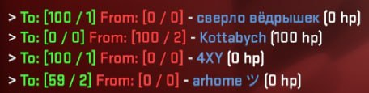
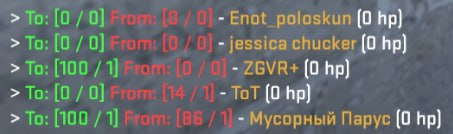

# DamageReport

[English](../README.md) | **Русский**

Плагин для **Counter-Strike 2** на базе [CounterStrikeSharp](https://github.com/roflmuffin/CounterStrikeSharp), который в конце каждого раунда показывает игроку в чате, сколько урона он нанёс каждому сопернику и сколько получил от него в ответ.

<table>
<tr>
<td width="50%"></td>
<td width="50%"></td>
</table>

## Возможности

- Персональный отчёт по каждому сопернику после окончания раунда.
- Учитывается **фактический** урон по здоровью (разница HP до и после попадания), поэтому «лишний» урон при убийстве не завышает цифры.
- Для каждого соперника показывается урон, количество попаданий и оставшееся здоровье.
- Урон по своим и урон самому себе не учитываются.
- Статистика сбрасывается в начале каждого раунда.
- Не требует настройки: поставил и работает.

## Как это выглядит

В конце раунда каждый игрок за T или CT получает по одной строке на каждого соперника:

```
> To: [74 / 3] From: [27 / 1] - PlayerName (0 hp)
> To: [0 / 0] From: [100 / 2] - AnotherPlayer (100 hp)
```

| Поле | Цвет | Значение |
| --- | --- | --- |
| `To: [урон / попадания]` | зелёный | сколько урона вы нанесли этому сопернику и за сколько попаданий |
| `From: [урон / попадания]` | красный | сколько урона этот соперник нанёс вам и за сколько попаданий |
| `PlayerName` | цвет команды | ник соперника |
| `(N hp)` | — | здоровье соперника на момент конца раунда |

<!--
Дополнительные скриншоты (раскомментируйте, когда файлы будут добавлены):

-->

## Требования

- Сервер CS2 с установленными [Metamod:Source](https://www.sourcemm.net/) и [CounterStrikeSharp](https://docs.cssharp.dev/) (версия **with runtime**).
- API `CounterStrikeSharp.API` **1.0.373** или новее.
- Для сборки из исходников — [.NET SDK 10](https://dotnet.microsoft.com/download) (проект таргетит `net10.0`).

## Установка

### Из релиза (рекомендуется)

1. Скачайте `DamageReport-<версия>.zip` на странице [Releases](https://github.com/FlamesC0der/DamageReport/releases).
2. Распакуйте архив в папку `game/csgo/` вашего сервера. Нужный путь уже внутри архива:

   ```
   addons/counterstrikesharp/plugins/DamageReport/
   ├── DamageReport.dll
   ├── DamageReport.deps.json
   └── DamageReport.pdb
   ```

3. Перезапустите сервер или загрузите плагин командой в консоли сервера:

   ```
   css_plugins load DamageReport
   ```

### Сборка из исходников

1. Соберите плагин:

   ```bash
   git clone https://github.com/FlamesC0der/DamageReport.git
   cd DamageReport
   dotnet build -c Release
   ```

   Готовые файлы появятся в `.build/DamageReport/`.

2. Скопируйте папку `DamageReport` на сервер, чтобы получилось так:

   ```
   game/csgo/addons/counterstrikesharp/plugins/DamageReport/
   └── DamageReport.dll
   ```

   Например, через `rsync`:

   ```bash
   rsync -avz --delete \
     .build/DamageReport/ \
     user@your-server:/path/to/game/csgo/addons/counterstrikesharp/plugins/DamageReport
   ```

3. Перезапустите сервер или загрузите плагин командой в консоли сервера:

   ```
   css_plugins load DamageReport
   ```

### Обновление без перезапуска сервера

Плагин поддерживает горячую перезагрузку:

```
css_plugins reload DamageReport
```

## Как это работает

| Событие | Что делает плагин |
| --- | --- |
| `player_hurt` | Считает фактический урон как `HP до − HP после` и записывает его по паре «атакующий → жертва». Игнорирует урон по своим, самому себе и урон без атакующего (падение, мир и т. д.). |
| `round_start` | Очищает накопленную статистику. |
| `round_end` | Отправляет каждому игроку в чат отчёт по всем соперникам. |

## Ограничения

- Отчёт получают только игроки в командах T и CT, наблюдатели его не видят.
- Начальное здоровье в раунде считается равным 100 HP. Если в режиме или другим плагином выдаётся больше 100 HP, первые попадания могут быть учтены неточно.
- Настроек (конфиг, команды, переводы) пока нет, формат сообщения зашит в коде.

## Автор

[FlamesC0der](https://github.com/FlamesC0der)
